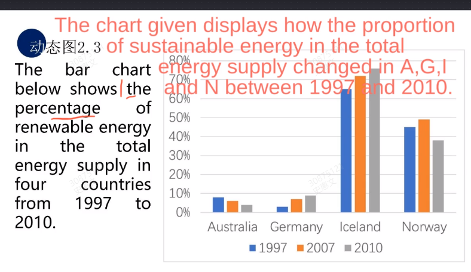
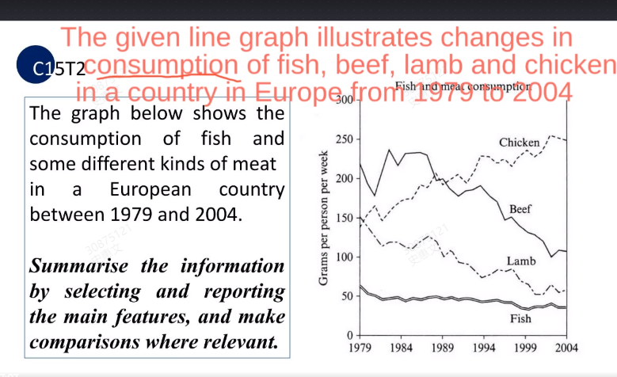
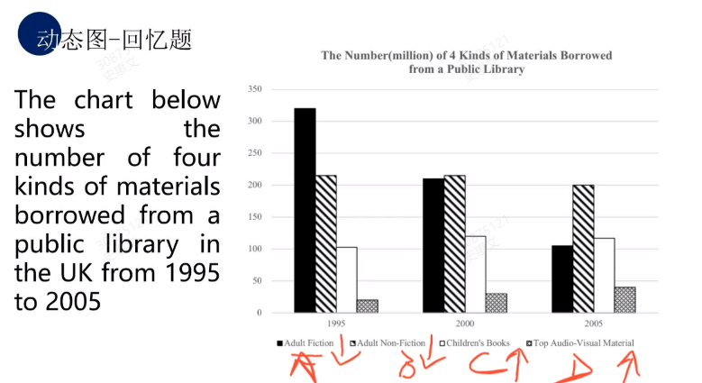
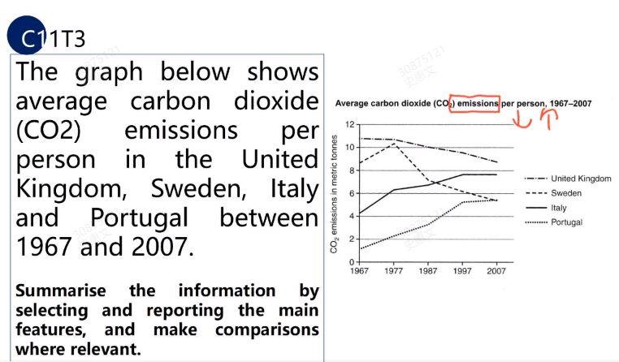
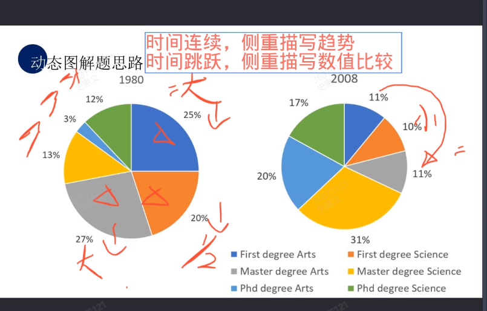
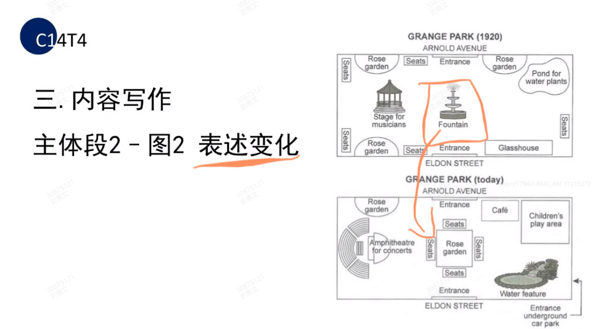
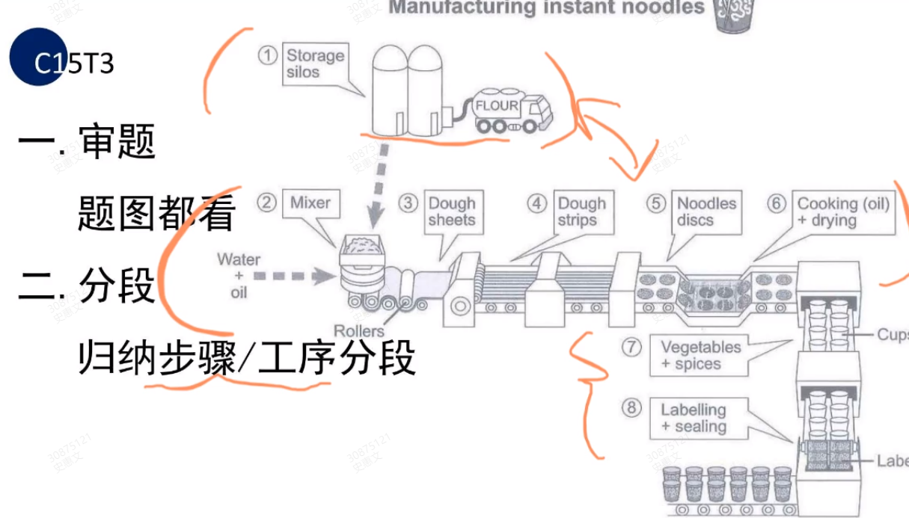

# 新东方雅思课：写作笔记

> 这份笔记根据课堂手写记录整理。原笔记中的课堂框架尽量保留；为方便复习而补写、纠错的内容，用“整理补充”标出。模板只是搭结构，写作时仍要根据题目调整。

## 目录

- [一、写作总览](#一写作总览)
- [二、大作文 Task 2](#二大作文-task-2)
  - [题型目录](#1-题型目录)
  - [审题与段落展开](#2-审题与段落展开)
  - [议论文：同意与否](#3-议论文同意与否)
    - [极端词题](#31-极端词题)
    - [对比题](#32-对比题)
    - [因果题](#33-因果题)
  - [议论文：双边讨论](#4-议论文双边讨论)
  - [议论文：利弊比较](#5-议论文利弊比较)
  - [说明文](#6-说明文)
  - [混合文](#7-混合文)
  - [语言、语法与衔接](#8-语言语法与衔接)
  - [时间安排与复习方法](#9-时间安排与复习方法)
- [三、小作文 Task 1](#三小作文-task-1)
  - [题型目录](#1-题型目录-1)
  - [通用写作结构](#2-通用写作结构)
  - [静态图表](#3-静态图表)
  - [数据表达](#4-数据表达)
  - [动态图表、地图与流程图](#5-动态图表地图与流程图)
- [四、自查清单](#四自查清单)

---

## 一、写作总览

雅思写作分为两部分：

- Task 1（小作文）：描述图表、地图或流程，重点是准确概括和比较信息。
- Task 2（大作文）：回应社会、教育、科技等议题，重点是立场、论证和展开。

### 四项评分维度

大作文主要看以下四点：

1. Task Response（任务回应）：立场是否清楚，论点是否扣题，解释和例子是否充分。
2. Coherence and Cohesion（连贯与衔接）：段落分工是否明确，句子之间是否自然衔接，指代是否清楚。
3. Lexical Resource（词汇）：用词是否准确、自然，并有一定变化。
4. Grammatical Range and Accuracy（语法）：是否能正确使用多种句式。

小作文的第一项是 Task Achievement（任务完成），主要看有没有选出并概括图表的核心特征。

> 整理补充：课堂速记里有“6 分每句一个错、6.5 分每篇 4—6 个错、7 分每篇 1—2 个错”一类说法。这只能当作提醒，不能当作官方评分公式。真实评分还会综合错误类型、频率和是否影响理解。

---

## 二、大作文 Task 2

### 1. 题型目录

#### 1.1 议论文

- 同意与否
  - 极端词题：`only`、`best`、`all`、`must` 等
  - 对比题：A 比 B 更好、更重要或更有效
  - 因果题：题目断言某个原因一定会导致某种结果
- 双边讨论：讨论两方观点，并按题目要求给出自己的看法
- 利弊比较：讨论优点和缺点，并判断哪一方更重要

#### 1.2 说明文

- 原因题
- 影响题
- 问题与解决办法
- 原因与解决办法
- 两问式说明题

#### 1.3 混合文

一部分要求解释原因、问题或影响，另一部分要求表达观点。例如：

- Why is this the case? Is it a positive or negative development?
- What are the reasons? Do you think this trend is beneficial?

### 2. 审题与段落展开

#### 2.1 先找题目的逻辑骨架

审题时先圈出：

- 绝对词：`only`、`all`、`never`、`the best`
- 比较词：`more important than`、`better than`、`rather than`
- 因果词：`lead to`、`result in`、`because`
- 任务词：`agree or disagree`、`discuss both views`、`advantages outweigh disadvantages`

这些词决定文章需要回应什么。改写题目时不要把它们删掉，否则容易把题目写偏。

#### 2.2 立场要清楚

开头表明立场，结尾再重申一次。正文每段都要服务于这个立场，不能中途换边。

可以完全同意或完全反对，也可以部分同意，但“部分同意”必须说清楚边界。例如：

> I agree that public transport should receive more funding, but I do not believe that it is the only effective way to reduce congestion.

#### 2.3 一个段落怎样展开

课堂笔记的思路是：

1. 总述：本段的中心观点。
2. 解释：为什么成立，补出因果链。
3. 细节：举例、对比或说明结果。
4. 回扣：说明这一段怎样回应题目。

整理补充：例子不必宏大，关键是具体而且能证明论点。与其写“很多国家已经证明”，不如交代一个清楚的情境，例如道路拓宽为什么只能短期缓解拥堵。

### 3. 议论文：同意与否

#### 3.1 极端词题

##### 识别方式

题干出现 `only`、`best`、`all`、`always` 等词时，命题通常很绝对。除非确实能证明没有例外，否则偏向反对更容易展开。

##### 推荐结构

1. 开头：改写题干，保留极端词；明确表示同意或反对。
2. 主体一：承认题目观点中合理的部分。
3. 主体二：指出它不是唯一或最佳选择，并提出一个替代方案。
4. 主体三：再给一个替代方案，或解释原方案的局限。
5. 结尾：重申立场。

##### 课堂例题思路：免费、全天公共交通是不是解决拥堵的最佳方法

- 承认：公共交通确实重要，可能减少部分私家车出行。
- 反驳一：拓宽关键道路、优化路口也能缓解瓶颈。
- 反驳二：交通规划、错峰安排和停车政策同样会影响车流。
- 结论：公共交通是办法之一，但不是唯一或必然最有效的办法。

可用表达：

```text
Admittedly, this measure could alleviate the problem to some extent.
However, it is far from the only solution available.
Other measures, such as ..., may be equally effective.
```

注意：不要为了反对极端词而否定题目中的全部内容。先承认合理部分，再攻击“唯一”“全部”或“最好”这一层，论证会更稳。

##### 课堂例题思路：富裕国家是否应帮助世界各地所有需要援助的人

这道题的争议集中在 `all` 所限定的援助范围：

- 现实限制：任何国家的财政、药品和人员都有限，不可能覆盖所有需求。
- 国内责任：援助规模还要考虑本国发展和公共服务。
- 国际合作：有选择的援助仍有价值，例如捐赠药品和食品、协助应对传染病，并建立稳定的外交关系。

整理补充：题目的核心不是简单地“帮助”或“不帮助”，而是范围是否过大。写作时应避免把资源有限推导成完全拒绝国际援助。

#### 3.2 对比题

##### 识别方式

常见信号包括：

- A is more important than B.
- A is better than B.
- A should be used rather than / instead of B.

##### 推荐结构

1. 开头：保留 A 与 B 的比较关系，并明确更支持哪一方。
2. 主体一：承认较弱一方的合理性或好处。
3. 主体二：解释自己支持的一方为什么更好，展开理由一。
4. 主体三：展开理由二，并在需要时直接比较两方。
5. 结尾：重申比较结论。

##### 课堂例题思路：私人公司与政府谁更适合承担某项工作

可以从这些角度比较：

- 政府：能制定政策、提供公共服务和监管市场。
- 私人公司：决策通常更灵活，调动资源和响应市场可能更快。
- 风险：私人机构要遵守法律，政府也要防止垄断和低效。

整理补充：这类题不能把一方写成“全好”、另一方写成“全坏”。比较标准要统一，例如都从效率、资源、责任和监管角度讨论。

#### 3.3 因果题

##### 识别方式

题目把原因和结果直接连在一起，例如“A 的出现必然导致 B”。反对时可以攻击：

- 原因并不充分；
- 结果并非必然；
- 还有更重要的中间因素。

##### 推荐结构

1. 开头：改写题目中的因果关系，并给出立场。
2. 主体一：承认该原因在某些情况下会产生影响。
3. 主体二：指出第一个例外或反向结果。
4. 主体三：指出第二个例外，或解释真正起决定作用的因素。
5. 结尾：重申题目的因果判断过强或基本成立。

##### 课堂练习思路：人工智能的发展会导致更高的能源消耗

- 承认联系：模型训练和数据处理可能增加电力需求。
- 限定结果：硬件效率提升后，相同任务未必需要更多能源。
- 补充变量：最终能耗还取决于模型使用规模、数据中心效率和能源结构。
- 结论：人工智能会增加能耗的风险，但结果不是由技术发展单独决定的。

### 4. 议论文：双边讨论

常见题目：

> Discuss both views and give your own opinion.

`discuss both views` 表示两方都必须得到实质讨论。自己的立场可以放在开头和结尾，也可以在正文中用更多篇幅支持其中一方。

#### 推荐结构

1. 开头：改写两方观点，并表明自己倾向哪一方。
2. 主体一：解释观点 A，给出理由或例子。
3. 主体二：解释观点 B 的第一个理由。
4. 主体三：继续支持观点 B，或比较两方后说明自己的判断。
5. 结尾：概括两方，再重申立场。

开头参考：

```text
Some people argue that A, while others believe that B. Personally, I find the latter view more convincing.
```

正文提示：

```text
Those who support A may argue that ...
This view is understandable because ...
Supporters of B, however, point out that ...
```

不要把“双边讨论”写成只提一句反方、其余全写自己。两边都要有解释，而不是只有观点标签。

### 5. 议论文：利弊比较

常见题目：

> Do the advantages outweigh the disadvantages?

这类题既要写优点，也要写缺点；`outweigh` 还要求做出权衡。

#### 推荐结构

1. 开头：重述现象，明确优点是否大于缺点。
2. 主体一：讨论相对较弱的一面。
3. 主体二：讨论较强一面的理由一。
4. 主体三：讨论较强一面的理由二，或直接完成权衡。
5. 结尾：重申哪一面更重要，以及判断标准。

整理补充：所谓“权衡”不能只靠句子 `the advantages outweigh the disadvantages`。需要说明为什么，例如影响人数更多、持续时间更长、后果更严重，或者问题能够被控制。

### 6. 说明文

说明文不一定要求站队，重点是完整回答题目中的每个问题。

#### 常见结构

1. 开头：改写题目，并说明文章将回答哪些问题。
2. 主体一：回答第一个问题，通常写两个相关原因或方面。
3. 主体二：回答第二个问题，通常写两个办法、影响或结果。
4. 结尾：概括主要原因和解决方向。

可用句型：

```text
This problem can be explained from two perspectives.
One major reason is that ...
Another factor is ...
To address this problem, governments / individuals should ...
```

结尾参考：

```text
In conclusion, this problem is mainly caused by ... . Addressing it requires ... .
```

整理补充：`This essay will discuss ...` 可以用，但不要把开头写成很长的“文章导航”。直接改写题目并交代回答方向通常更自然。

### 7. 混合文

混合文把说明和议论放在同一道题里。先判断每一个问句是什么任务，再分段回答。

#### 推荐结构

1. 开头：改写现象，简要回答说明性问题，并给出个人立场。
2. 主体一：回答说明性问题，例如原因或影响。
3. 主体二：承认与自己立场相反的一面。
4. 主体三：解释自己的立场。
5. 结尾：概括说明性答案，并重申立场。

可用衔接：

```text
Admittedly, ...
However, I still believe that ...
In conclusion, this trend is largely driven by ... and is, on balance, ...
```

注意：两个问题都要回答。不要因为第二问要求表态，就把第一问只写成开头的一句话。

### 8. 语言、语法与衔接

#### 8.1 词汇：准确优先

课堂记录中的替换：

| 较口语或不准确 | 更适合正式写作 |
| --- | --- |
| let | allow / enable |
| kid | child |
| problem | issue / challenge（按语境选择） |
| boss | manager / supervisor |
| can't | cannot |
| study knowledge | acquire / gain knowledge |
| make something less important | trivialise / undermine the importance of |

数量词要区分可数与不可数：

- 可数：`many`、`a large number of`、`numerous`
- 不可数：`much`、`a large amount of`
- 两者都可在合适语境使用：`a lot of`、`plenty of`

整理补充：不要为了“高级”而机械换词。`problem` 本身没有错，`issue` 和 `challenge` 也不能在所有语境下互换。

#### 8.2 语法多样性

课堂提到的句式包括：

- 状语从句：原因、时间、条件、让步
- 定语从句：`which`、`that`、`who`
- 名词性从句：`that`、`whether` 等引导的从句
- 比较级：`more`、`better`、`less`
- 情态动词：`will`、`can`、`may`、`might`
- 被动语态：`be + past participle`
- 非谓语：`doing` 常表主动，`done` 常表被动或完成

整理补充：句式越复杂不等于分数越高。先保证主谓关系、时态和标点正确，再考虑变化。

#### 8.3 指代与连接

可以用这些方式减少重复：

- `this` / `it`：必须能清楚对应前文内容。
- `one` / `ones`：替代前面出现过的可数名词。
- `such + noun`：回指前面提到的一类事物。
- `which means that ...`：解释前一句的结果。

不要使用含糊的指代。正式议论文中也尽量避免泛指的 `you`、`your`。

连接词按逻辑使用，不要每句都塞一个：

- 补充：`Furthermore`、`In addition`
- 转折：`However`、`while`
- 让步：`Admittedly`
- 结果：`Therefore`、`as a result`

### 9. 时间安排与复习方法

#### 考场时间

课堂建议将大作文控制在约 40 分钟：

- 审题、列提纲和写开头：约 5 分钟
- 正文：约 30 分钟
- 结尾与检查：约 5 分钟

课堂速记中写了“开头 1—2 分钟、正文每段 10 分钟、结尾 1—2 分钟”。实际练习时可以按个人速度调整，但要给审题和检查留出时间。

#### 复习步骤

1. 按题型积累材料，而不是背一篇通用模板。
2. 每道题先列出立场、主体段主题句和例子。
3. 完成后检查立场是否清楚、论点是否扣题。
4. 记录反复出现的语法错误，下次写作重点检查。
5. 使用 AI 修改时，先自己重写，再比较建议；不要直接背生成的整篇文章。

课堂记录的难度感受是：议论文 > 混合文 > 说明文。这不是固定规律，但可以用来安排复习时间。

---

## 三、小作文 Task 1

### 1. 题型目录

#### 1.1 数据图表

- 柱状图（bar chart）
- 折线图（line graph）
- 饼图（pie chart）
- 表格（table）
- 混合图表

按数据特点还可以分为：

- 静态图表：没有明显时间变化，重点比较同一时点的数据。
- 动态图表：包含时间轴，重点描述变化趋势。

#### 1.2 非数据图

- 地图题（map）
- 流程图（process diagram / flow chart）

### 2. 通用写作结构

#### 第一段：改写题目

保留图表类型、对象、时间和单位，用同义表达或句式变化改写题目。

常用动词：

```text
show / illustrate / display / provide information about
```

`provided` 可以作后置修饰语，表示“题目中给出的”，但不是必需用法，也不决定整句话的时态：

```text
The bar chart provided compares ...
The table illustrates ...
```

#### 第二段：Overview

概括最明显的两三个特征，不堆细节数字。可以关注：

- 最大值和最小值；
- 明显分组或总体差异；
- 动态图中的总体升降、峰值和交叉。

#### 第三至四段：细节

常见分组办法：

- 一个图一段；
- 把趋势或数值接近的对象放在一起；
- 按时间、类别或高低分组。

整理补充：不需要逐个抄完所有数字。选择能支持 Overview 的数据，并用比较关系组织细节。

### 3. 静态图表

#### 3.1 写作重点

1. 判断图表的对象、时间和单位。
2. 找出最高、最低和接近的数据。
3. 按相似性分组，不按图表顺序机械罗列。
4. Overview 写总体特征，主体段再放数字。

#### 3.2 Overview 示例

总体比较：

```text
Overall, the figures for A were higher than those for B in every category except C.
```

最大值与最小值：

```text
Overall, A recorded the highest figure, whereas B had the lowest.
```

多个饼图：

```text
Overall, A accounted for the largest share in the first chart, while B was the biggest category in the second.
```

整理补充：原笔记中的 `always` 容易写得过强。只有数据在所有相关项目中都成立时，才使用 `always` 或 `consistently`。

#### 3.3 主体段衔接

```text
Focusing first on ...
Turning to ...
As for ...
In terms of ...
By contrast, ...
Meanwhile, ...
This was followed by ...
```

### 4. 数据表达

#### 4.1 占比

```text
A accounted for 42% of the total.
A represented / constituted 42% of the total.
A made up 42% of the total.
```

#### 4.2 排名

```text
A ranked first, followed by B.
B was the second-largest category.
```

注意：`rank second` 前面通常不加 `the`；`the second-largest category` 中需要 `the`。

#### 4.3 比较

```text
The figure for lunch was higher than that for breakfast.
A was similar to B.
A and B recorded the same percentage, at 20%.
```

使用 `that` / `those` 替代重复名词：

- 单数或不可数：`that for breakfast`
- 复数：`those for other groups`

#### 4.4 约数

`approximately`、`about`、`around` 和 `roughly` 都可以表示“约”。`nearly` 表示“接近但尚未达到”，方向更加明确，不能随意互换。

```text
approximately / about / around / roughly 20%
nearly 20%  (接近但低于 20%)
```

#### 4.5 倍数与分数

```text
The figure for A was nearly twice that for B.
The figure for A was half that for B.
The figure for A was one third of that for B.
The figure for A was two thirds of that for B.
```

#### 4.6 范围

```text
The figures ranged from 10% to 20%.
The figures were between 10% and 20%.
```

不要混写成 `between 10% to 20%`。

### 5. 动态图表、地图与流程图

> 根据 2026 年 11 月 14 日课堂笔记、后续补课截图及 day4 讲义整理。方法和例句已转为文字，保留必要例题图；纠错与复习提醒属于整理补充。

### 一 审题与文章结构

小作文的任务：**概括信息、选择并报告主要特征、在适当处比较**。不解释图表未提供的原因，不加入个人观点。

| 类型 | 判断依据 | 描写重点 |
| --- | --- | --- |
| 动态数据图 | 同一指标随时间变化 | 趋势、幅度、极值、排名与交点 |
| 静态数据图 | 没有时间变化 | 大小、占比、类别间差异 |
| 地图题 | 地点布局或规划变化 | 方位、增减、替换、保留 |
| 流程图 | 制造、回收或自然过程 | 起终点、阶段、顺序、原料与产物 |

审题时确认：图表类型 → 时间与时态 → 单位 → 描述对象 → 最突出特征 → 主体段分组。

- 图表本身通常用现在时介绍：The graph **illustrates** ...；图中历史数据用过去时：... how the figure **changed** ...。
- 时态必须看题目：过去用过去时，预测用预计表达，不能把“动态图”直接等同于过去时。
- `the number of + 可数复数`：the number of students；整个名词短语作主语时谓语用单数。
- `the amount of + 不可数名词`：the amount of water。
- `the percentage/proportion of ...`：百分比或占比；`the figure for ...`：替代前文已明确的数值指标。
- emissions、consumption、sales 可直接作为指标；不能写成“国家本身上升下降”。

课堂采用四段结构：**开头段 → 概述段 → 主体段一 → 主体段二**。主体段按关系分组，便于比较，而非机械地逐个年份罗列。

### 二 开头段改写

基本结构：**图表类型 + 展示动词 + 指标与对象 + 地点或时间**。

| 改写手段 | 可用表达 | 注意 |
| --- | --- | --- |
| 明确图表类型 | line graph / bar chart / pie charts / table | graph 与 chart 不必强行互换 |
| 替换展示动词 | shows / illustrates / displays / gives information about | 单张图用 illustrates，多张用 illustrate |
| 替换时间表达 | between A and B / from A to B | 不写 between A to B |
| 改变句型 | illustrates changes in ... / illustrates how ... changed | how 后接完整从句 |
| 补充图中信息 | 列出国家、类别或单位 | 只补图中真实信息，避免开头过长 |

#### 例题一 四国可再生能源占比



The bar chart illustrates how the proportion of renewable energy in the total energy supply changed in Australia, Germany, Iceland and Norway between 1997 and 2010.

注意保留 **renewable energy** 的含义，不能为了替换词而随意改成含义更宽的 sustainable energy。

#### 例题二 鱼与肉类消费量



The line graph illustrates changes in the weekly amounts of chicken, beef, lamb and fish consumed per person in a European country between 1979 and 2004.

指标是人均每周消费量，图中单位为 grams per person per week；不能只记住 consumption 而漏掉单位与统计口径。

### 三 动态图概述段

写法：**各组整体趋势 + 最突出的一至两个特征**，例如变化最大、始终最高、最终排名逆转。通常不堆具体数字，细节留给主体段。

> Overall, the figures for A and B increased, whereas those for C and D declined. Meanwhile, E remained relatively stable.

> A experienced the largest change. / A saw the largest increase/decrease.

> A consistently recorded the highest figure.

先比较起点与终点，再看过程。中途有波动也可以有整体上升趋势，但不能把有明显回落的曲线说成 increased throughout。

可再生能源例题概述：

> Overall, the share of renewable energy increased in Iceland and Germany, whereas it declined in Norway and Australia. Iceland consistently recorded the highest proportion.

#### 例题三 图书馆四类资料借阅量



> Overall, borrowing of adult fiction and adult non-fiction declined, whereas the figures for children's books and audio-visual materials increased. Adult fiction experienced the largest decrease.

**纠错：图中统计的是资料借阅数量，不是借阅人数。** 成人非小说类整体略降，不能只凭某一中间年份判断方向。

#### 例题四 人均二氧化碳排放量



> Overall, average CO2 emissions per person declined in the United Kingdom and Sweden, whereas they rose in Italy and Portugal. The United Kingdom consistently recorded the highest figure.

注意保留 **per person**，避免把人均排放写成全国总排放。

### 四 动态图主体段

#### 1 分组与选数

分组依据：大小关系或总体趋势。每组突出起点、终点、明显转折、峰谷和重要交点；课堂“约选 8—12 个数据”是练习参考，不是每道题必须满足的数量。

主体段内部：段首点明对象 → 完整描写一个对象 → 转入另一个对象并比较。

- Focusing initially on A and B, ... 首先看……
- As for ... / With regard to ... / In terms of ... 至于……
- Turning to ... 转向……
- Similarly / Likewise 相似；In contrast / By contrast 相反。

#### 2 趋势动词与幅度

| 意义 | 动词及过去式 | 名词 |
| --- | --- | --- |
| 上升 | increase–increased; rise–rose; grow–grew; climb–climbed | an increase / a rise / growth / a climb |
| 下降 | decrease–decreased; decline–declined; fall–fell; drop–dropped | a decrease / a decline / a fall / a drop |
| 暴涨 | soar / jump / surge | a surge / a jump |
| 暴跌 | plummet / plunge / slump | a plunge / a slump |
| 不变 | remain unchanged / stable / constant | a period of stability |
| 波动 | fluctuate | fluctuations |

| 表达维度 | 副词 | 对应形容词 |
| --- | --- | --- |
| 幅度大 | sharply / dramatically / significantly | sharp / dramatic / significant |
| 幅度小 | slightly / marginally | slight / marginal |
| 速度快慢 | rapidly / slowly | rapid / slow |
| 变化方式 | gradually / steadily | gradual / steady |

**补充提醒：** slowly 是速度慢，slightly 是幅度小；steadily 是稳定变化，不能一律当作“小幅”。soar、plummet 已有强烈变化含义，不必再堆 dramatically。

#### 3 四种上升下降句型

以下例句均为课堂句型练习数据：

1. **指标 + 动词 + 副词**：The number of visitors increased dramatically from 100 to 600 between 1980 and 1990.
2. **指标 + showed/saw/experienced + 形容词 + 名词**：The number of visitors showed a dramatic increase from 100 to 600 between 1980 and 1990.
3. **There was + 形容词 + 变化名词 + in + 指标**：There was a dramatic increase in the number of visitors from 100 to 600 between 1980 and 1990.
4. **时间段 + witnessed + 变化名词 + in + 指标**：The decade from 1980 to 1990 witnessed a dramatic increase in visitor numbers, from 100 to 600.

重点搭配：an increase **in** the number；a decline **in** consumption。第四种句型不用同时重复同一段时间两遍。

#### 4 数值与时间介词

| 表达 | 用法 | 例句 |
| --- | --- | --- |
| from / to | 起点 / 终点 | rose from 100 to 600 |
| by | 动词后的变化量 | increased by 500 |
| of | 变化名词后的幅度 | an increase of 500 |
| at | 稳定数值、起始数值或峰值 | remained stable at 200; peaked at 600 |
| between ... and ... | 波动范围 | fluctuated between 200 and 300 |
| in + 年份 | 某年 | stood at 100 in 1980 |
| over/during + 时间段 | 某段期间 | over the next decade |
| for + 时长 | 持续多久 | remained stable for three years |

> The figure remained unchanged at 200 until 1990.
>
> The figure stabilized at 200.（此前发生变化，之后趋稳；与始终不变不完全相同。）
>
> The figure experienced fluctuations between 200 and 300 from 1980 to 1990.

**百分比与百分点：** 从 20% 到 30% = 上升 10 percentage points；相对增幅为 50%。不能混写成 increased by 10% 来表达 10 个百分点。

#### 5 连接连续变化

课堂例句：留学生人数先逐渐上升到 2005 年的 3,000 人，再急升至 2010 年的 5,000 人。

> The number of students studying abroad increased gradually from 100 to 3,000 in 2005, and then rose sharply to 5,000 in 2010.

可替换句尾：

- ..., before rising sharply to 5,000 in 2010.
- ..., followed by a sharp rise to 5,000 in 2010.
- After increasing gradually to 3,000 in 2005, the number rose sharply to 5,000 in 2010.

也可用 followed by a decline to ... / a period of stability at ... / fluctuations between ... and ...。分词结构要保持逻辑主语一致。

#### 6 比较与交点

- 最高：A consistently recorded the highest figure.
- 第二：The figure for B remained the second highest.
- 相等：The figure for A reached the same level as that for B in 2000.
- 超过：The figure for A overtook/surpassed that for B in 2000.
- 倍数：The figure for A was twice that for B.

课堂建议先写起点较大的对象，再把“主动超过”放到后介绍的对象中，便于衔接；这是一种组织方式，不是唯一写法。比较对象必须同类：数值对数值、比例对比例。

#### 7 两个年份的动态图



只有 1980 与 2008 两个时间点，重点比较两端大小与占比变化；无法据此判断中间是逐年稳定变化还是波动。

图中可抓取：Master degree Arts 从 27% 降至 11%；Master degree Science 从 13% 升至 31%；PhD degree Arts 从 3% 升至 20%；First degree Arts 从 25% 降至 11%。概述可突出理科硕士占比最终最高，以及文科硕士显著下降。

#### 8 可再生能源主体段示例

> Focusing initially on Iceland and Norway, Iceland consistently recorded the highest share of renewable energy, rising gradually from around 65% in 1997 to approximately 75% in 2010. Norway remained second, with its figure increasing slightly to nearly 50% in 2007 before falling to about 38% in 2010.
>
> As for the other two countries, their proportions were significantly lower. Australia's share declined from just below 10% to around 5%, whereas Germany's rose from about 4% to just below 10%. By 2007, Germany's figure had overtaken Australia's.

讲义中的 significant lower 应改为 **significantly lower**；避免 the data for Australia 等笼统替代，明确写 share 或 figure。

### 五 地图题

#### 1 审题与分段

题干和地图一起看：确认时间、指南针、边界、道路、出入口和图例。无明确方位标识时可用 top/bottom、left/right，避免擅自认定北向。

两种主体段安排：

1. **每图一段**：先按空间顺序描述旧图，再按相同顺序描述新图变化。
2. **跨图对比**：按区域分段，每处直接写“原来是什么，现在变成什么”。适合变化较多的题。

开头：The maps illustrate changes to [地点], comparing its layout in [过去时间] with that of [现在/另一时间].

概述抓“变与不变 + 功能变化”，例如新增休闲设施、工业区改住宅区；不凭设施增加就推断经济更繁荣、容量翻倍或满足所有人的需求。

#### 2 方位词与句型

| 关系 | 表达 |
| --- | --- |
| 区域内部东侧 | in the east/eastern part of the park |
| 东北角、中心 | in the northeastern corner / in the centre |
| 相对某物以东 | to the east of the pool |
| 边缘、端点 | on the eastern edge / at the eastern end of the road |
| 对面 | opposite the entrance / on the opposite side of the road |
| 附近、相邻 | near / close to / next to |
| 沿路、河 | along / alongside the road/river |
| 左右 | to/on the left/right of ... |

补充提醒：on the east of 并非所有“接壤”关系都适用的万能搭配；优先用边界明确的 on the eastern edge of。on the opposite side of the road 与 opposite the entrance 也不能任意互换。

- There was a fountain in the centre of the park.
- A stage stood to the west of the fountain.
- A pond was located in the northeastern corner.
- The park contained a fountain, **with a stage to its west**.

#### 3 with 复合结构

结构：**with + 宾语 + 补语**。

- 介词短语：with a café nearby / with a farm to its south。
- 形容词：with the windows open。
- 现在分词：with the candle burning（主动或进行）。
- 过去分词：with his eyes closed（被动或状态）。

地图中常用 with + 设施 + 方位：A swimming pool stood in the centre, with a changing room to its west and a seating area to its east.

#### 4 变化表达与时态

| 变化 | 表达 |
| --- | --- |
| 新建、增加 | be built / constructed / added |
| 拆除、移走 | be demolished / removed / knocked down |
| 扩大、缩小 | be enlarged / extended / reduced in size |
| 替换 | A be replaced by B |
| 改造用途 | A be converted/transformed into B |
| 保留 | remain unchanged / be retained / be preserved |
| 搬迁 | be relocated to ... |
| 腾出空间 | be demolished to make way for ... |

过去与过去比较用过去时；过去到现在可用现在完成时写变化；未来规划用 will be / is planned to be / is expected to be，不能写成已经建好。

> The pond, which was once in the northeastern corner, has been replaced by a children's play area.
>
> A rose garden now occupies the centre, where the fountain once stood.
>
> The former stage has been demolished to make way for an amphitheatre.

#### 5 例题 Grange Park



保留这一张完整的新旧地图；另一张重复地图截图已合并。观察路线：出入口 → 中心 → 西侧 → 东北与东南。

| 原设施 | 现在的变化 |
| --- | --- |
| 中央喷泉 | 中央玫瑰园，四周有座椅 |
| 西侧音乐台 | 露天剧场 |
| 东北水生植物池 | 儿童游乐区，附近新增咖啡馆 |
| 东南温室 | 水景，附近新增地下停车场入口 |
| 周边玫瑰园与座椅 | 重新布置；西北玫瑰园保留 |

概述：

> Overall, the park retains its flower gardens, water features, seating and music facilities, while a café and a children's play area have been added.

主体段示例：

> In 1920, the park had entrances on its northern and southern sides, leading from Arnold Avenue and Eldon Street respectively. A fountain stood in the centre, with a stage for musicians to its west. A pond for water plants occupied the northeastern corner, while a glasshouse stood farther south. Rose gardens and seats were arranged around the edges.
>
> Today, a rose garden surrounded by seats occupies the former fountain site. The stage has been replaced by an amphitheatre, while the pond has given way to a children's play area and a café has been added nearby. A water feature has replaced the glasshouse, and a new entrance to an underground car park has been introduced in the southeast. The northwestern rose garden remains.

**讲义纠错：** underground park 应为 **underground car park**。不要沿用 we can find a glasshouse lay 这类双谓语错误，改为 A glasshouse stood ...。

### 六 流程图

#### 1 审题与组织

先确认：线性还是循环、起点与终点、标号步骤数、原料和辅助投入、设备、最终产物。按生产阶段分主体段，不必强求两段步数相等。

开头：The diagram illustrates how instant noodles are manufactured.

概述：Overall, the process consists of eight stages, beginning with the storage of flour and ending with the labelling and sealing of cups.

概述中的 begin with 与 end with 后保持结构一致。图有编号时按编号数步骤；没有编号时可归纳阶段，不随意硬凑数量。

#### 2 例题 方便面生产



保留完整生产图；相同流程图的重复截图及局部放大已转为下表与句型。

| 步骤 | 原料、动作与结果 | 英文表达 |
| --- | --- | --- |
| 1 | 面粉储存于筒仓 | Flour is stored in silos. |
| 2 | 加水与油搅拌 | Flour is mixed with water and oil in a mixer. |
| 3 | 压成面片 | The dough is pressed into sheets by rollers. |
| 4 | 切成面条 | The sheets are cut into strips. |
| 5 | 制成面饼 | The strips are shaped into noodle discs. |
| 6 | 油烹并干燥 | The discs are cooked in oil and then dried. |
| 7 | 面饼装杯，添加蔬菜与调料 | The dried noodles are placed in cups with vegetables and spices. |
| 8 | 贴标并密封 | The cups are labelled and sealed. |

主体段一写 1—6 的面饼制造，主体段二写 7—8 的装杯包装。

#### 3 语法与衔接

一般制造流程常用 **一般现在时 + 被动语态**：原料/产品 + is/are + 过去分词 + 设备/结果/目的。自然过程若主体自行变化，则用主动语态，不要所有流程都强行被动。

| 连接方式 | 句型与例句 |
| --- | --- |
| 起始 | In the initial stage, flour is stored in silos. |
| 后续 | Next / Subsequently / In the following stage, ... |
| 完成后 | Once this stage has been completed, ... |
| before | The discs are cooked before being dried. |
| after | After the dough has been mixed, it is pressed into sheets. |
| where | Flour enters a mixer, where it is blended with water and oil. |
| which | The dough is pressed into sheets, which are then cut into strips. |
| 结束 | Finally / In the final stage, the cups are labelled and sealed. |

不熟悉过去分词时可换成 The next step is to + 动词原形，但仍应掌握常用不规则形式，如 grind–ground、heat–heated、dry–dried。不能靠换句型省略关键过程。

#### 4 完整示例

> The diagram illustrates the process used to manufacture instant noodles.
>
> Overall, production involves eight stages, beginning with flour storage and ending with the labelling and sealing of cups. The noodles are first prepared and dried before being packaged with vegetables and spices.
>
> In the initial stage, flour is delivered by truck and stored in silos. It is then transferred to a mixer, where water and oil are added. The resulting dough is passed through rollers to form sheets, which are subsequently cut into strips. These strips are shaped into noodle discs before being cooked in oil and dried.
>
> Following the drying stage, the noodle discs are placed in cups. Vegetables and spices are added to each cup, after which the cups are labelled and sealed, completing the manufacturing process.

### 七 讲义阅读时要避开的错误

- **人数不能写成百分比：** Melbourne 活动图的 film club、martial arts 数据是参与人数，不能写 65%、35% 或 participation rates，应用 participants / the number of people。
- **最终排名前后矛盾：** 讲义把 table tennis 与 musical performances 都写成最终第二，不能直接照抄。应以题图为准；讲义给出的终点约为 55 与 20，也不支持两者并列。
- **时间起终点要算清楚：** 2003 到 2006 相隔三年，宜直接写 between 2003 and 2006，避免含糊写 over these four years。
- **表格内部国名混淆：** 临时移民工人范文末句把 7.2 对应成 New Zealand，但前文已将 New Zealand 写为 5.2，须回原表核对，不能凭范文记数字。
- **只描述可见变化：** 新增码头不自动等于载客容量翻倍；新增商店不自动等于整个体育中心商业化。
- **两端数据不能证明全过程：** 两张饼图只能说明两个年份间的差异，慎用 steadily、continuously、throughout。
- **循环流程需看箭头：** 塑料瓶回收形成新产品，并不意味着图中所有新产品都会再次回到起点，不自行补闭环。

### 八 复习与练习安排

课堂短期重点：先练动态图与静态图，至少独立完成一篇，并根据实际用时调整。长期参考：每周四篇，约每天一篇、每周练四天；再逐渐加入地图与流程题。

20 分钟参考安排：审题构思 3 分钟 → 开头 1—2 分钟 → 概述 2—3 分钟 → 两个主体段约 10—12 分钟 → 留时间检查。练习目标是**速度与准确性一起提升**，不要为套满句型牺牲内容。

交卷前检查：

- [ ] 开头写准指标、对象、时间、单位，未改变题意。
- [ ] 概述抓住整体特征，没有只罗列细节。
- [ ] 主体段有分组、有比较、有关键数据或步骤。
- [ ] number / amount / percentage 使用正确。
- [ ] from / to / by / of / at，百分比与百分点区分清楚。
- [ ] 时态、单复数、被动语态及过去分词正确。
- [ ] 地图没有虚构方位或效果；流程没有遗漏或添加步骤。
- [ ] 题图与文字相互对应，近似数据使用 about / around / approximately。

---

## 四、自查清单

### 大作文

- [ ] 我是否完整回答了题目中的每一个任务？
- [ ] 开头和结尾的立场是否一致？
- [ ] 每个主体段是否只有一个清楚的中心？
- [ ] 观点后面是否有解释、结果或具体例子？
- [ ] 极端词、比较关系和因果关系是否被保留并回应？
- [ ] 指代是否明确，连接词是否符合实际逻辑？
- [ ] 有没有为了用“高级词”而造成搭配错误？

### 小作文

- [ ] 是否写了清楚的 Overview？
- [ ] Overview 是否只概括主要特征，没有堆数字？
- [ ] 单位、时态和比较对象是否准确？
- [ ] 是否选择了有代表性的数据，而不是逐项抄写？
- [ ] `that`、`those`、倍数、分数和范围表达是否正确？
